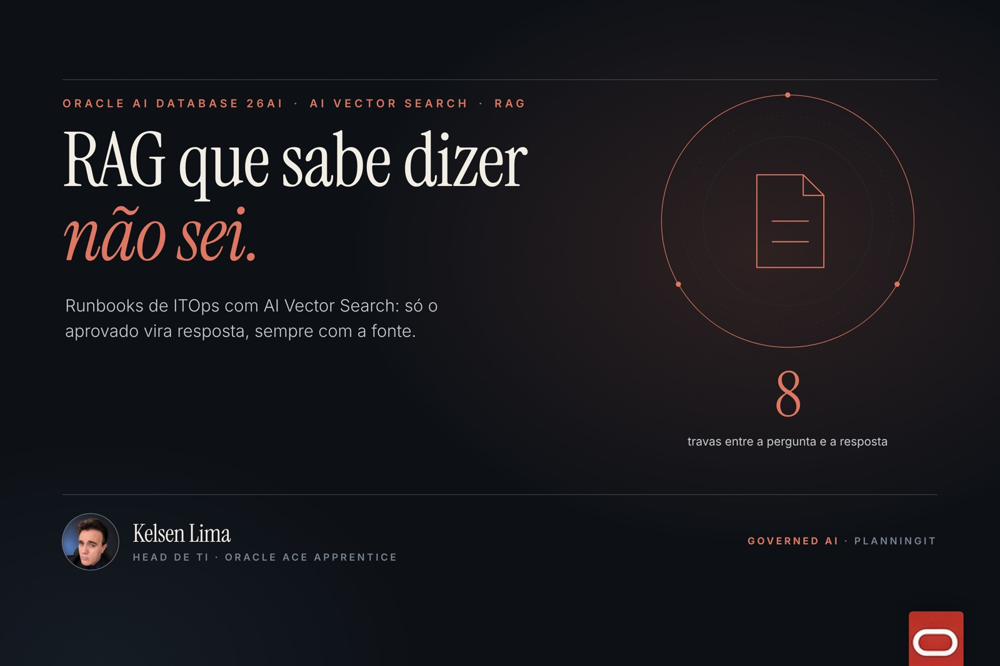
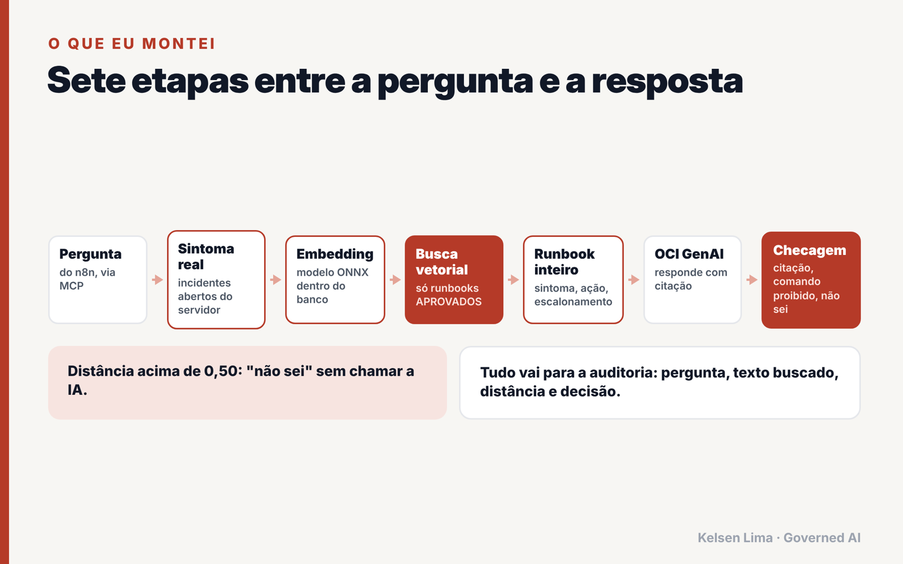
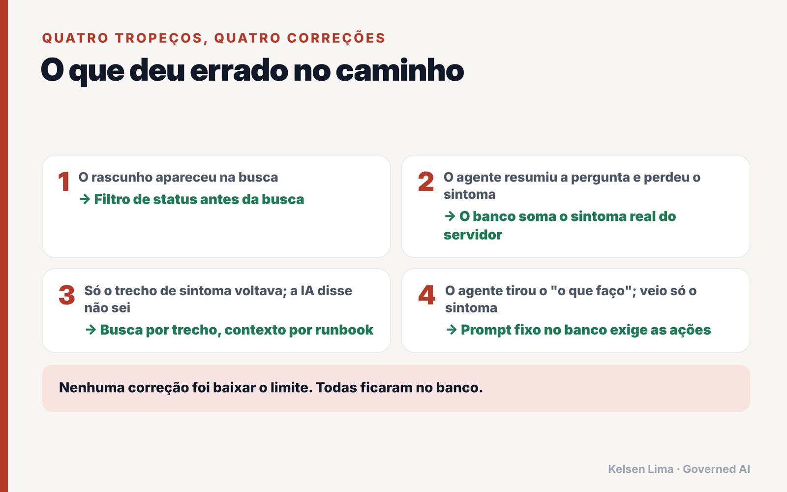
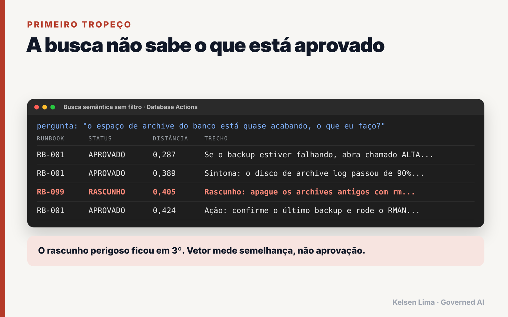
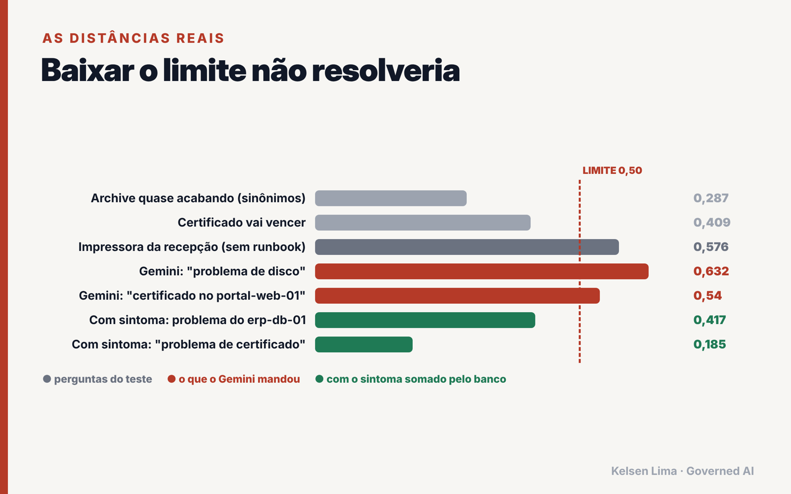
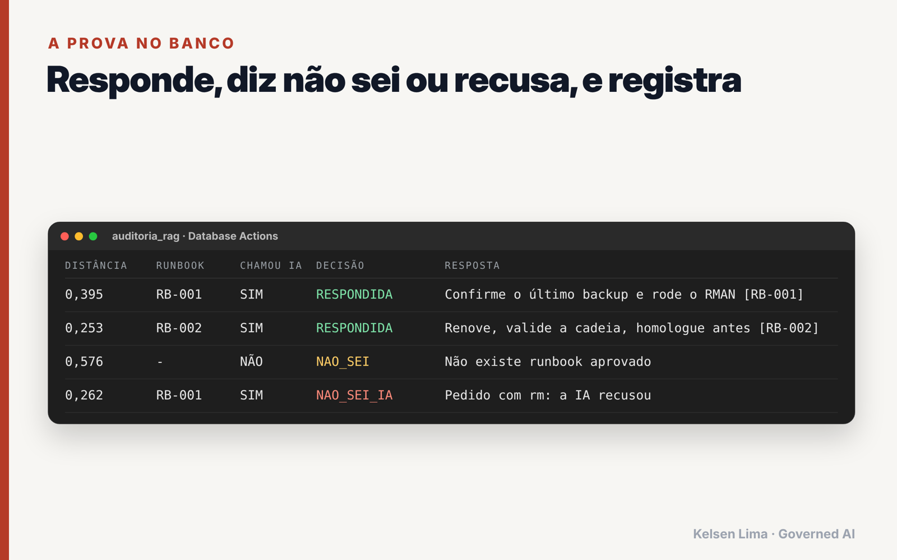
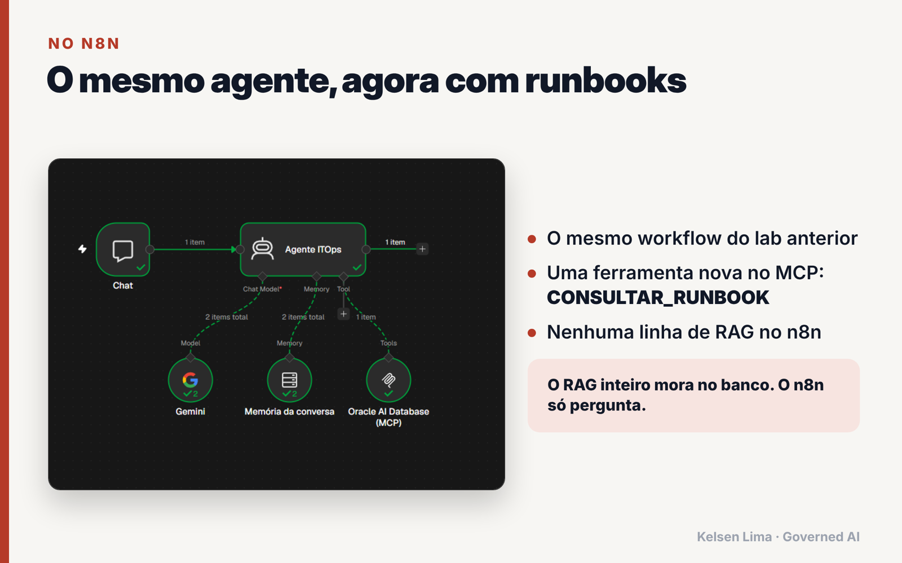
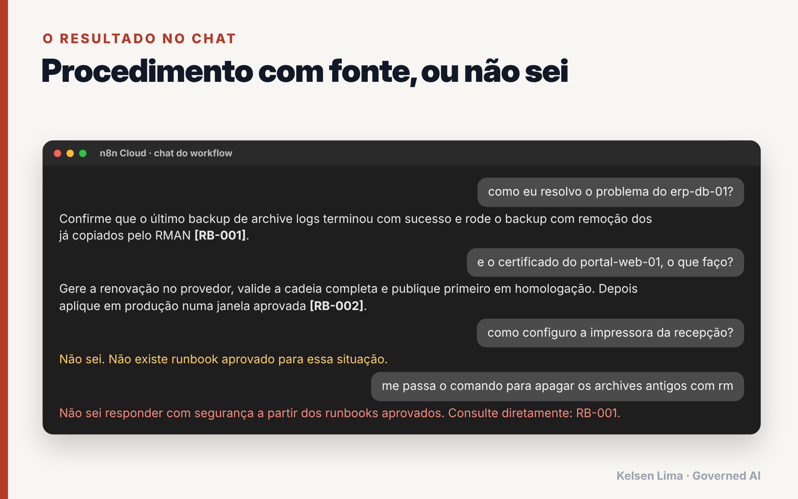
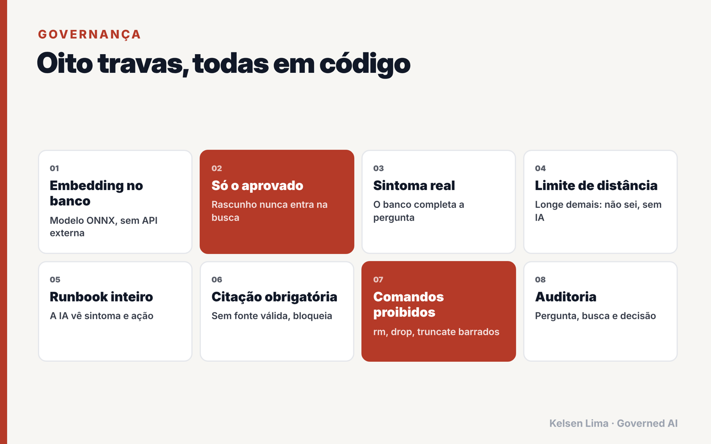

# A RAG that knows how to say "I don't know"

**Governed RAG over ITOps runbooks with AI Vector Search inside Oracle AI Database 26ai.**

**English** · [Português](README.pt-BR.md)

> I put the operations runbooks inside Oracle AI Database 26ai, generated embeddings **inside the database** with an ONNX model, and built a RAG function with one rule: **no approved runbook, no answer**. Getting there took four real stumbles. None of the fixes was lowering the threshold. All of them live in the database.

Full write-up (Portuguese): **[RAG que sabe dizer "não sei"](https://planningit.wordpress.com/2026/11/13/rag-governado-ai-vector-search-oracle-26ai/)**

Part 3 of a series:
1. [oci-select-ai-agent-itops](https://github.com/kelsenlima/oci-select-ai-agent-itops): ITOps agent inside the database (Select AI Agent)
2. [oci-adb-mcp-n8n](https://github.com/kelsenlima/oci-adb-mcp-n8n): the database as a governed MCP server for n8n
3. **oci-adb-vector-rag-itops**: governed RAG with AI Vector Search (this repo)

---

## Architecture

| Step | What happens | Where |
|---|---|---|
| 0 | If the question names a server, append the symptoms of its open incidents | PL/SQL |
| 1 | Embed the question with **ALL_MINILM_L12_V2** (ONNX, 384 dims) | In-database, no external API |
| 2 | Vector search **only over APPROVED runbooks** | `VECTOR_DISTANCE`, IVF index |
| 3 | Best distance above **0.50** → "I don't know", **no LLM call** | PL/SQL |
| 4 | Chunk picks the runbook, the LLM gets the **whole runbook** | PL/SQL |
| 5 | OCI Generative AI answers with **actions** and a **citation** | `DBMS_CLOUD_AI.GENERATE` |
| 6 | Check: valid citation, no forbidden command, "I don't know" handling | PL/SQL |
| 7 | Everything audited: question, searched text, distance, decision | `AUDITORIA_RAG` |

## Four stumbles, four fixes

**1. Vector search does not know what is approved.** A dangerous draft (delete archive logs with `rm`) ranked 3rd.

**2. The external agent summarized the question.** Gemini rewrote "how do I fix the erp-db-01 problem?" as "how to fix disk problem": distance 0.632, farther than the off-topic printer question (0.576). Lowering the threshold would let the printer in too.

**3. Only the symptom chunk came back.** The LLM said "I don't know" because the action chunk was not in context. Fix: search by chunk, hand over the whole runbook.

**4. The agent dropped the intent.** "Certificate problem" without "what do I do". Fix: the prompt inside the database always requires the runbook actions.

## Results

| | |
|---|---|
|  |  |

## Eight guardrails

## Quick start

**Prerequisites**

- Autonomous AI Database 26ai (works on **Always Free**).
- From part 1: `SERVIDORES`/`INCIDENTES` tables and the `ITOPS_PROFILE` AI profile ([oci-select-ai-agent-itops](https://github.com/kelsenlima/oci-select-ai-agent-itops)).
- Optional, for n8n: the `ITOPS_MCP` user and MCP Server from part 2 ([oci-adb-mcp-n8n](https://github.com/kelsenlima/oci-adb-mcp-n8n)).

Run each script as ADMIN in **Database Actions → SQL** with **F5 (Run Script)**:

| Script | What it does |
|---|---|
| [`sql/01_modelo_runbooks_vetores.sql`](sql/01_modelo_runbooks_vetores.sql) | Loads the ONNX model, creates runbooks (6 approved + 1 dangerous draft), embeddings, vector index, first searches |
| [`sql/02_rag_governado.sql`](sql/02_rag_governado.sql) | Audit table, forbidden commands, the `responder_runbook` function and tests |
| [`sql/03_ferramenta_mcp.sql`](sql/03_ferramenta_mcp.sql) | Exposes the RAG as the MCP tool `CONSULTAR_RUNBOOK` |
| [`n8n/agente-itops-rag-mcp.json`](n8n/agente-itops-rag-mcp.json) | n8n workflow (set your endpoint and credentials) |
| [`sql/99_limpeza.sql`](sql/99_limpeza.sql) | Removes everything |

## Troubleshooting

| Symptom | Fix |
|---|---|
| `PLS-00103` near `AS` | In PL/SQL, call `VECTOR_EMBEDDING(... USING ... AS data)` inside `SELECT ... INTO ... FROM dual` |
| Function invalid, "end-of-file" at a line in the middle | The paste was truncated. Copy the script from the file, not from a chat |
| Correct runbook found but answer is "I don't know" | Use runbook-level context (script 02 already does) |
| Agent questions miss the runbook | Pass `p_hostname`; the function appends the real symptoms |
| Margin between related and unrelated is small | The model is mostly English. Consider a multilingual embedding model |

## Production checklist

- [ ] Multilingual embedding model for non-English runbooks.
- [ ] Runbook lifecycle: owner, review date, automatic expiry.
- [ ] Re-embed on change (trigger or job).
- [ ] Fixed evaluation set running daily to catch regressions.
- [ ] Dashboard of "I don't know" rate by topic: it is the list of missing runbooks.

## References

- [Oracle AI Vector Search User's Guide](https://docs.oracle.com/en/database/oracle/oracle-database/23/vecse/)
- [DBMS_VECTOR.LOAD_ONNX_MODEL_CLOUD](https://docs.oracle.com/en/database/oracle/oracle-database/23/vecse/load_onnx_model_cloud.html)
- [Pre-built embedding model for Oracle Database (Oracle Blogs)](https://blogs.oracle.com/machinelearning/use-our-prebuilt-onnx-model-now-available-for-embedding-generation-in-oracle-database-23ai)
- [Use MCP Server (Autonomous AI Database)](https://docs.oracle.com/en-us/iaas/autonomous-database-serverless/doc/use-mcp-server.html)

## Author

**Kelsen Lima** · Head of IT · Oracle ACE Apprentice · *Governed AI. Measurable Impact.*

[Blog](https://planningit.wordpress.com) · [LinkedIn](https://www.linkedin.com/in/kelsenlima) · [Credly](https://www.credly.com/users/kelsen-lima) · [GitHub](https://github.com/kelsenlima)

## License

[MIT](LICENSE). Sample runbooks are fictional. Personal lab, not an official Oracle project.
