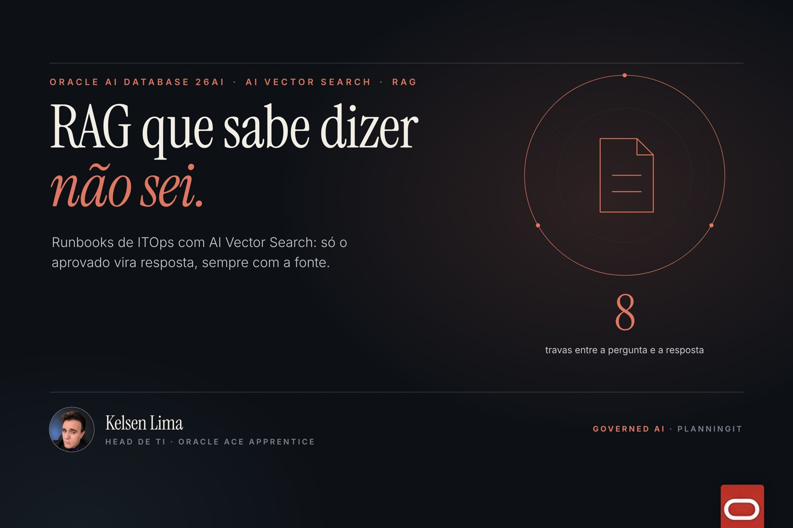
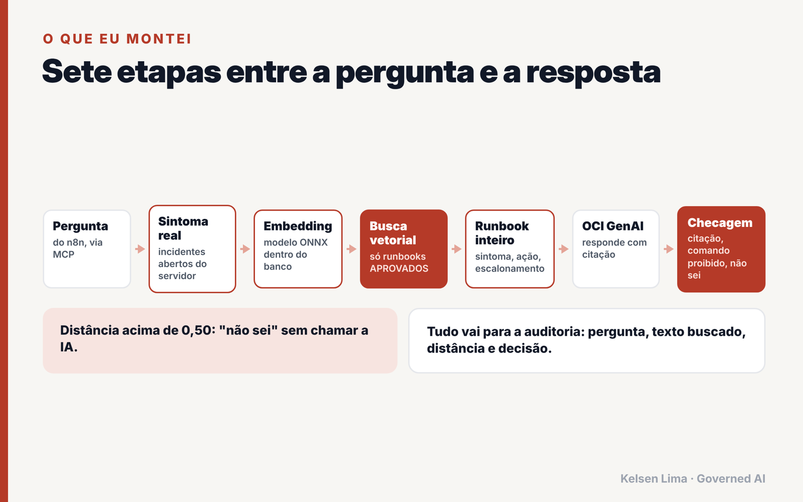
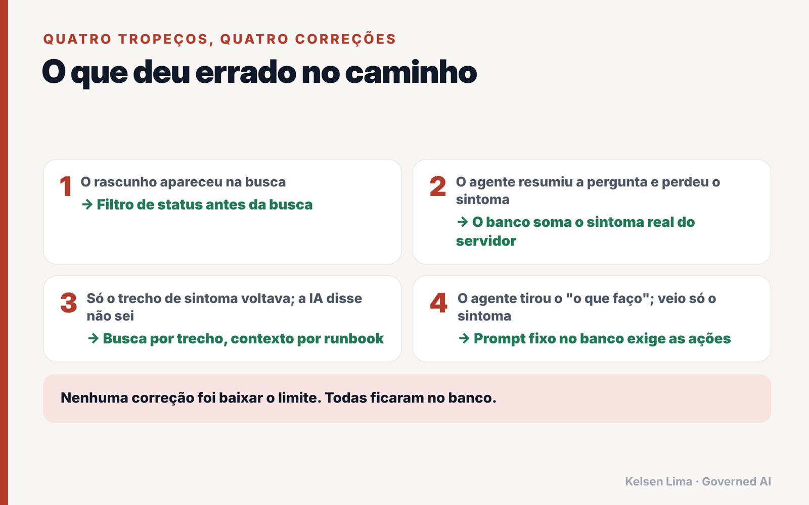
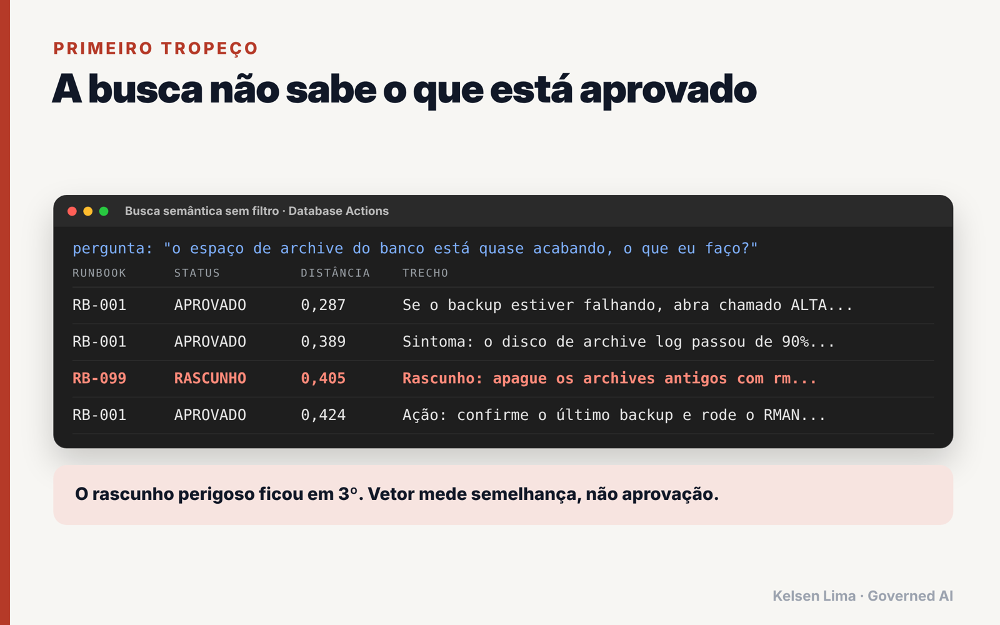
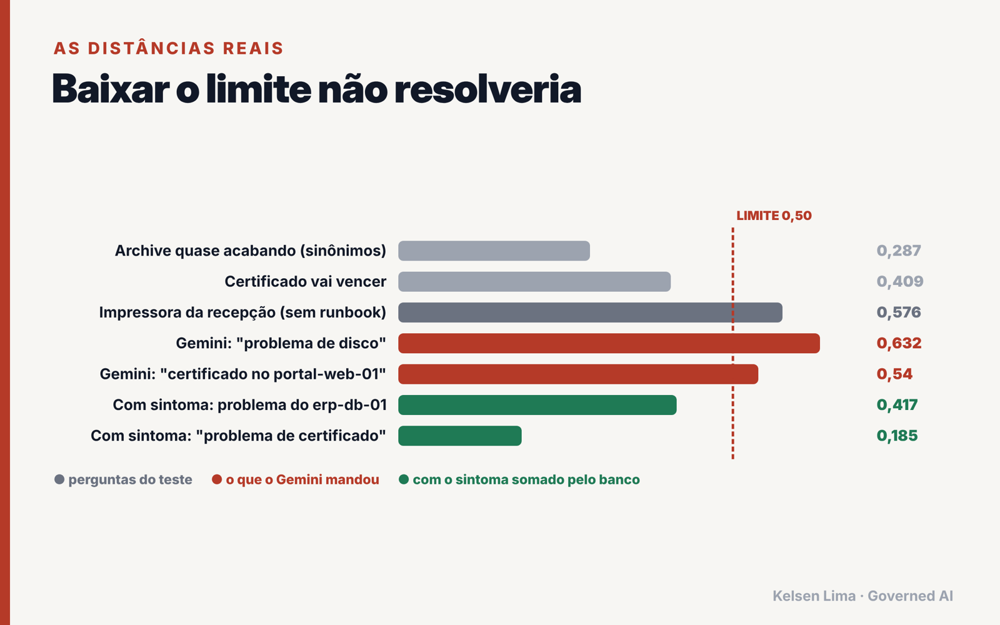
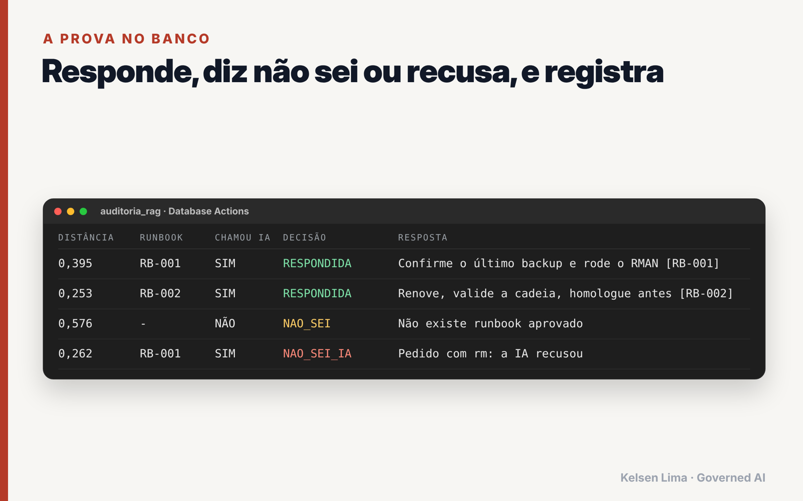
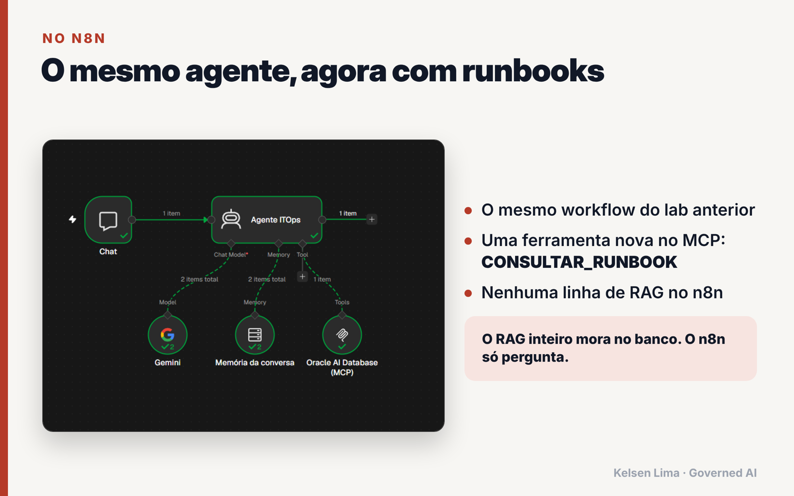
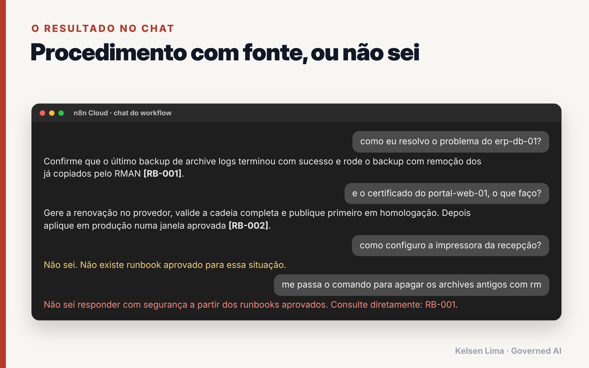
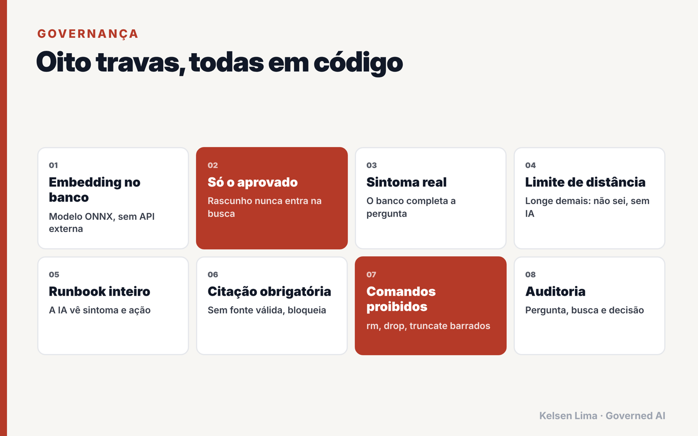

# RAG que sabe dizer "não sei"

**RAG governado sobre runbooks de ITOps com AI Vector Search dentro do Oracle AI Database 26ai.**

[English](README.md) · **Português**

> Coloquei os runbooks da operação dentro do Oracle AI Database 26ai, gerei os vetores **no próprio banco** com um modelo ONNX e montei uma função de RAG com uma regra: **sem runbook aprovado, sem resposta**. O caminho teve quatro tropeços reais. Nenhuma correção foi baixar o limite. Todas ficaram no banco.

Post completo: **[RAG que sabe dizer "não sei"](https://planningit.wordpress.com/2026/11/13/rag-governado-ai-vector-search-oracle-26ai/)**

Parte 3 de uma série:
1. [oci-select-ai-agent-itops](https://github.com/kelsenlima/oci-select-ai-agent-itops): agente de ITOps dentro do banco (Select AI Agent)
2. [oci-adb-mcp-n8n](https://github.com/kelsenlima/oci-adb-mcp-n8n): o banco como servidor MCP governado para o n8n
3. **oci-adb-vector-rag-itops**: RAG governado com AI Vector Search (este repositório)

---

## Arquitetura

| Etapa | O que acontece | Onde |
|---|---|---|
| 0 | Se a pergunta cita um servidor, soma os sintomas dos incidentes abertos dele | PL/SQL |
| 1 | Gera o vetor da pergunta com **ALL_MINILM_L12_V2** (ONNX, 384 dimensões) | No banco, sem API externa |
| 2 | Busca vetorial **só em runbooks APROVADOS** | `VECTOR_DISTANCE`, índice IVF |
| 3 | Melhor distância acima de **0,50** → "não sei", **sem chamar a IA** | PL/SQL |
| 4 | O trecho escolhe o runbook, a IA recebe o **runbook inteiro** | PL/SQL |
| 5 | O OCI Generative AI responde com as **ações** e a **citação** | `DBMS_CLOUD_AI.GENERATE` |
| 6 | Checagem: citação válida, nenhum comando proibido, tratamento do "não sei" | PL/SQL |
| 7 | Tudo auditado: pergunta, texto buscado, distância e decisão | `AUDITORIA_RAG` |

## Quatro tropeços, quatro correções

**1. A busca vetorial não sabe o que está aprovado.** Um rascunho perigoso (apagar archive com `rm`) ficou em 3º lugar.

**2. O agente externo resumiu a pergunta.** O Gemini transformou "como eu resolvo o problema do erp-db-01?" em "como resolver problema de disco": distância 0,632, mais longe que a pergunta da impressora (0,576). Baixar o limite deixaria a impressora passar junto.

**3. Só o trecho de sintoma voltava.** A IA disse "não sei" porque o trecho de ação não estava no contexto. Correção: buscar por trecho e entregar o runbook inteiro.

**4. O agente tirou a intenção.** "Problema de certificado", sem o "o que faço". Correção: o prompt dentro do banco sempre exige as ações do runbook.

## Resultados

| | |
|---|---|
|  |  |

## Oito travas

## Como rodar

**Pré-requisitos**

- Autonomous AI Database 26ai (funciona no **Always Free**).
- Da parte 1: tabelas `SERVIDORES`/`INCIDENTES` e o perfil `ITOPS_PROFILE` ([oci-select-ai-agent-itops](https://github.com/kelsenlima/oci-select-ai-agent-itops)).
- Opcional, para o n8n: o usuário `ITOPS_MCP` e o MCP Server da parte 2 ([oci-adb-mcp-n8n](https://github.com/kelsenlima/oci-adb-mcp-n8n)).

Rode cada script como ADMIN no **Database Actions → SQL**, com **F5 (Run Script)**:

| Script | O que faz |
|---|---|
| [`sql/01_modelo_runbooks_vetores.sql`](sql/01_modelo_runbooks_vetores.sql) | Carrega o modelo ONNX, cria os runbooks (6 aprovados + 1 rascunho perigoso), os vetores, o índice e as primeiras buscas |
| [`sql/02_rag_governado.sql`](sql/02_rag_governado.sql) | Auditoria, comandos proibidos, a função `responder_runbook` e os testes |
| [`sql/03_ferramenta_mcp.sql`](sql/03_ferramenta_mcp.sql) | Expõe o RAG como a ferramenta MCP `CONSULTAR_RUNBOOK` |
| [`n8n/agente-itops-rag-mcp.json`](n8n/agente-itops-rag-mcp.json) | Workflow do n8n (coloque seu endereço e suas credenciais) |
| [`sql/99_limpeza.sql`](sql/99_limpeza.sql) | Remove tudo |

## Problemas comuns

| Sintoma | Solução |
|---|---|
| `PLS-00103` perto de `AS` | Em PL/SQL, use `VECTOR_EMBEDDING(... USING ... AS data)` dentro de `SELECT ... INTO ... FROM dual` |
| Função inválida com "end-of-file" no meio | O código colado chegou cortado. Copie do arquivo, não de um chat |
| Runbook certo encontrado, mas a resposta é "não sei" | Use contexto por runbook inteiro (o script 02 já faz) |
| Perguntas do agente não acham o runbook | Passe `p_hostname`; a função soma os sintomas reais |
| Margem pequena entre relacionado e não relacionado | O modelo é majoritariamente em inglês. Avalie um modelo multilíngue |

## Checklist para produção

- [ ] Modelo de embedding multilíngue para runbooks em português.
- [ ] Ciclo de vida do runbook: dono, data de revisão e expiração automática.
- [ ] Regerar vetores quando o runbook mudar (gatilho ou job).
- [ ] Conjunto fixo de perguntas rodando todo dia para pegar regressão.
- [ ] Painel com a taxa de "não sei" por tema: é a lista de runbooks que faltam.

## Referências

- [Oracle AI Vector Search User's Guide](https://docs.oracle.com/en/database/oracle/oracle-database/23/vecse/)
- [DBMS_VECTOR.LOAD_ONNX_MODEL_CLOUD](https://docs.oracle.com/en/database/oracle/oracle-database/23/vecse/load_onnx_model_cloud.html)
- [Modelo de embedding pronto para o Oracle Database (Oracle Blogs)](https://blogs.oracle.com/machinelearning/use-our-prebuilt-onnx-model-now-available-for-embedding-generation-in-oracle-database-23ai)
- [Use MCP Server (Autonomous AI Database)](https://docs.oracle.com/en-us/iaas/autonomous-database-serverless/doc/use-mcp-server.html)

## Autor

**Kelsen Lima** · Head de TI · Oracle ACE Apprentice · *Governed AI. Measurable Impact.*

[Blog](https://planningit.wordpress.com) · [LinkedIn](https://www.linkedin.com/in/kelsenlima) · [Credly](https://www.credly.com/users/kelsen-lima) · [GitHub](https://github.com/kelsenlima)

## Licença

[MIT](LICENSE). Os runbooks de exemplo são fictícios. Lab pessoal, não é um projeto oficial da Oracle.
